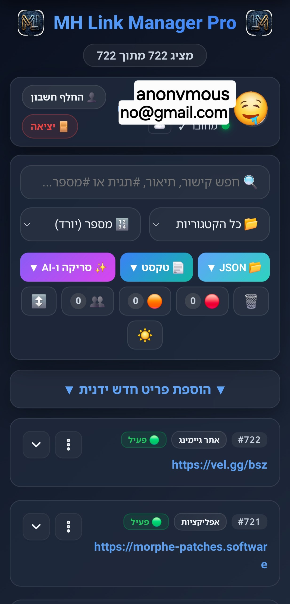

  

  <h1>🔗 MH Link Manager Pro</h1>

  
<b>אפליקציית PWA מתקדמת לניהול קישורים, פקודות וטקסטים בענן. משלבת סנכרון מאובטח בזמן אמת, עבודה מלאה ללא רשת (Offline First), אבחון רשת רב-שכבתי, מפענחי פלטפורמות ייעודיים ומנוע AI מרובה ספקים עם ראייה ממוחשבת (Vision) ואימות עצמי.</b>

   
  
    

---

## 🎯 חזון ומטרת המערכת

**MH Link Manager Pro** מחליפה את מערכת המועדפים המיושנת של הדפדפן ומתפקדת כמאגר ידע חכם וחי עבור קישורים, קטעי קוד וטקסטים חשובים.

במקום לשמור כתובת גולמית בלבד, המערכת בודקת את זמינות הקישור ברמת ה־DNS וה־HTTP, שולפת תוכן אמיתי (כולל צילום מסך חי של האתר ומטא־דאטה מובנה), ומנתחת אותו באמצעות מנועי בינה מלאכותית עם שכבת בקרת איכות עצמית. כך כל פריט במאגר כולל תיאור עובדתי בעברית, תגיות חיפוש חכמות, תגית פלטפורמה וחיווי סטטוס אמין (🟢 פעיל, 🟠 דומיין בחניה או 🔴 לא זמין / שגיאת שרת).

---

## ✨ יכולות המערכת

### 🤖 מנוע AI מרובה ספקים, ראייה ממוחשבת ואימות עצמי
* **גיבוי אוטומטי מלא בין ספקים ומפתחות (Multi-Key Fallback):** תמיכה ב־3 ספקי AI עם עד **3 מפתחות API לכל ספק** (עד 9 מפתחות במקביל) ומעבר אוטומטי בזמן אמת במקרה של חריגת מכסה (429/Quota) או שגיאת תקשורת:
  * 🔹 **Google Gemini** (`gemini-2.5-flash`, `gemini-2.5-flash-lite` ועוד) — כולל תמיכה ב־**Google Search Grounding (`🌐`)** כאשר חסר מידע בדף.
  * ⚡ **Groq** (`Llama 4 Scout Vision`, `Llama 3.3 70B`, `Llama 3.1 8B`).
  * 🌐 **OpenRouter** (מודלים חינמיים כגון `Gemini 2.0 Flash`, `Llama 3.3 70B`, `Qwen 2.5 72B`).
* **ניתוח ויזואלי באמצעות צילום מסך חי (`📸 Vision AI`):** המערכת לוכדת צילום מסך דחוס של האתר (דרך Microlink / thum.io / Canvas) ושולחת אותו למודלי Vision כדי להבין גם אתרים דינמיים או עמודים עם מעט טקסט.
* **שומר סף ובקרת איכות (Self-Verification Engine):** מנוע אימות אוטומטי שמונע הזיות וניחושים (חוסם ביטויים כמו *"ככל הנראה"*, *"בהתבסס על שם הדומיין"*, שגיאות `Failed to fetch` או תיאורים גנריים) ומונע מה־AI לסמן בטעות קישור פעיל כמת.
* **תיקון מרוכז בלחיצה אחת (`🛠️`):** כפתור ייעודי שמאתר אוטומטית את כל הכרטיסים שחסר להם פיענוח, שמכילים ניחושים/שגיאות או שמסומנים כלא מאומתים — וסורק אותם מחדש.
* **שקיפות מלאה ושליטה ידנית:** חיווי אייקון ו־Tooltip של המודל המדויק שביצע את הפיענוח (כולל סימון `🌐` לחיפוש חי ו־`📸` לצילום מסך), סריקה מחדש מהירה מתוך הכרטיס (`🔄`), עריכה ידנית של סטטוס/סיכום/תגיות (`🤖✏️`), ותפריט סריקה צף בלחיצה ארוכה או קליק ימני על `✨` (לבחירת ספק, בדיקת סטטוס מהירה או מצב DNS/מידע מוכר ללא גרידת תוכן).
* **בודק מפתחות מובנה (`🔍 בדוק מפתחות`):** בדיקת תקינות חיה מול שרתי Gemini, Groq ו־OpenRouter ישירות מתוך חלון ההגדרות, לצד אופציה לסריקה אוטומטית של כל פריט חדש שנוסף.

### 🌐 אבחון רשת רב-שכבתי ומפענחי פלטפורמות ייעודיים
* **אימות DNS כפול (DoH):** בדיקה מול Google DNS ו־Cloudflare DNS לזיהוי ודאי של דומיינים שאינם קיימים (`NXDOMAIN`) בלי התראות שווא.
* **זיהוי מדויק של תקלות שרת, Soft-404 ודומיינים בחניה:** הבחנה ברורה בין שגיאות שרת (`500`, `502`, `503`, `504`, Cloudflare `520–526`, `1101`), עמודים שהוסרו/פגי תוקף (`404`, `410`, `451` ודפי שגיאה רכים), ודומיינים בחניה/למכירה (`🟠 Parked`).
* **שליפת תוכן מרובת שכבות:** שילוב מקבילי של AllOrigins, Microlink, CorsProxy ו־**Jina Reader (`r.jina.ai`)** לפענוח אתרי SPA ומסכי Cloudflare, חילוץ `JSON-LD`, כותרות, תפריטים ו־`alt` של תמונות, ובדיקת עמוד הבית הראשי כאשר תת־עמוד דל בטקסט.
* **מפענח טלגרם רב-שכבתי (`✈️ Telegram`):** שליפה מקבילית מ־5 ערוצים (כרטיס ראשי, ערוץ ציבורי `/s/`, ווידג'ט פוסט `?embed=1`, Microlink ו־Jina) לזיהוי ערוצים, קבוצות, בוטים, Mini-Apps, פוסטים, תיקיות (`addlist`), מדבקות, חבילות שפה/עיצוב, שרתי פרוקסי והזמנות — כולל זיהוי קישורים פגי תוקף ללא מחיקות שווא.
* **מפענח GitHub ייעודי (`🐙 GitHub`):** שימוש ישיר ב־GitHub API לשליפת תיאור מאגר, שפת פיתוח, כוכבים, תגיות, תקציר `README`, קבצי שחרור (Releases) ופרופילי מפתחים/ארגונים.
* **מפענח הזמנות Discord (`💬 Discord`):** אימות קישורי הזמנה דרך Discord API v9 (שם שרת, תיאור, כמות חברים וזיהוי הזמנות שפג תוקפן).
* **תגיות פלטפורמה אוטומטיות:** זיהוי והצגה אוטומטית של תגיות `Telegram`, `GitHub`, `YouTube`, `Amazon`, `AliExpress` ו־`Discord`.

### ⚡ חלון סריקה צף (Scan Dock) וניהול פעולות מרובות
* **חלון סריקה צף בזמן אמת:** מציג את הכתובת הנסרקת כרגע, מד התקדמות, מונה (`X/Y`) וסטטיסטיקה חיה (🟢 פעיל / 🟠 חניה / 🔴 תקלה).
* **שליטה מלאה בסריקה:** תמיכה ב**השהייה והמשך (`⏸️`/`▶️`)**, **ביטול מיידי (`⏹️`)** המפסיק בקשות רשת פתוחות באמצעות `AbortController`, ו**מזעור לבועה צפה (`⚡`)** שמאפשרת להמשיך לעבוד במאגר בזמן הסריקה.
* **מצב בחירה מרובה תלוי-הקשר (Bulk Actions):** כניסה בלחיצה ארוכה או קליק ימני על כל כרטיס, עם בחירת "בחר הכל" החלה רק על התוצאות המסוננות כרגע — לביצוע סריקת AI לנבחרים, בדיקת סטטוס מהירה, ניקוי ניתוחי AI, העברת קטגוריה או העברה לסל המחזור.

### 🔍 חיפוש, סינון מהיר וניהול כרטיסים
* **חיפוש רב־ממדי:** חיפוש חי לפי כתובת, תיאור, קטגוריה, הערה אישית, תקציר AI, `#תגית`, `#מספר` פריט (למשל `#42`), `#כפול` או סטטוס מדויק.
* **תגיות סינון לחיצות על כל כרטיס:** לחיצה על מספר הפריט, הקטגוריה, הפלטפורמה, הסטטוס, תגית ה־AI או תגית הכפילות מסננת את המאגר בלחיצה אחת (עם כפתור ביטול מהיר בהתראה).
* **כפתורי סינון מהיר עם מונים חיים:** כפתורי סינון לקישורים לא זמינים (`🔴`), דומיינים בחניה (`🟠`) וכפילויות (`👥`) עם תגיות מספר מתעדכנות בזמן אמת, לצד כפתור פתיחה/סגירה לכל הכרטיסים (`↕️`), נעיצת פריטים (`📌`) ומיון לפי תאריך, שם או מספר סידורי.
* **עדכון חלק ללא קפיצות מסך:** עדכון כרטיסים במקום (`updateCardInPlace`) עם עיגון גלילה מדויק ושמירת גובה (`content-visibility: auto`) כך שסריקת AI או עריכה ידנית של תיאור/הערה לעולם לא מקפיצות את המסך.

### 📤 ייצוא וייבוא חכם עם הגנת פרטיות
* **ייצוא ל־TXT עם הגנת פרטיות כברירת מחדל:** מתג **`🛡️ ללא קטגוריית פרטי`** מופעל כברירת מחדל בתפריט טקסט, מציג ספירה חיה של פריטים פרטיים שיוחרגו ומייצא קובץ נקי עם סיומת `_NoPrivate.txt`. כיבוי המתג מייצא את כל המאגר כולל פרטי.
* **ייצוא וגיבוי JSON (`Schema v6`):** כולל מתג תואם בתפריט JSON (מוגדר כברירת מחדל לגיבוי מלא, ובלחיצה אחת מייצא `_NoPrivate.json`) ושמות קבצים מתוארכים אוטומטית (`MH_Link_Manager_Pro_YYYY-MM-DD_HH-MM-SS`).
* **ייבוא חכם ומיזוג (Smart Merge):** תמיכה בייבוא קובצי JSON וקובצי TXT (הן בפורמט מובנה עם שדות תיאור/קטגוריה/הערה והן כרשימת קישורים פשוטה), תוך דילוג אוטומטי על כפילויות וכתיבה באצוות (Batched Writes) ל־Firestore.

### ☁️ ענן, Offline First, פרטיות ואבטחה
* **עבודה ללא רשת וסנכרון חי:** מבוסס על Firebase Firestore v10 עם `persistentLocalCache` (IndexedDB) ו־Service Worker, המאפשרים צפייה, חיפוש, עריכה ושמירה מקומית גם ללא חיבור לאינטרנט וסנכרון אוטומטי כשהרשת חוזרת.
* **גישה מורשית ובידוד נתונים:** התחברות מאובטחת עם Google (Firebase Auth), בידוד נתונים מלא לפי UID והגבלת גישה לרשימת חשבונות מורשים (`ADMIN_EMAILS`).
* **ניקוי מקומי מוחלט ביציאה:** התנתקות מוחקת לחלוטין את מטמון ה־IndexedDB מהמכשיר (`terminate` + `clearIndexedDbPersistence`).
* **שמירת סודות בדפדפן בלבד:** מפתחות ה־API של ספקי ה־AI נשמרים ב־`localStorage` המקומי בלבד ולעולם אינם נשלחים ל־Firestore.
* **סל מחזור מלא (`🗑️`):** מחיקה רכה (Soft Delete) עם אפשרות ביטול מיידית (Undo), שחזור פריט בודד, שחזור הכל, מחיקה לצמיתות או ריקון הסל, וכן כפתור רענון מלא מול הענן (`☁️`).

### 🎨 חוויית משתמש (UI/UX) ומחוות
* **עיצוב Glassmorphism רספונסיבי:** תמיכה במצב לילה ויום (`☀️`/`🌙`) ומסך פתיחה והתחברות מותאם במיוחד למסכי מובייל.
* **מנוע החלקה לסגירה אוניברסלי (Swipe to Dismiss):** החלקה אופקית (במגע ובגרירת עכבר) לסגירת התראות, חלון הסריקה, תפריטים נפתחים וחלונות קופצים.
* **מערכת התראות מתקדמת (Toasts):** כוללת בר ספירה לאחור מסונכרן וצבוע לפי סוג ההתראה (הצלחה/שגיאה/אזהרה/מידע), כפתור ביטול (`Undo`) והשהייה אוטומטית במעבר עכבר במחשב (`pointerType === 'mouse'`).
* **סגירה מדורגת ב־`Escape` ובלחיצה ברקע:** מקש `Escape` סוגר בסדר היררכי חכם (מודלים ← סל מחזור ← תפריטים ← מצב בחירה מרובה), ולחיצה על הרקע הכהה סוגרת חלונות עריכה בלי להפריע לסימון טקסט.

---

## 📁 מבנה הקבצים בפרויקט

| קובץ | תפקיד מהותי |
| :--- | :--- |
| `index.html` | קובץ הליבה של ה־SPA. מכיל את כל מבנה ה־HTML, עיצוב ה־CSS המוטמע ולוגיקת ה־JavaScript (ES Modules) המלאה לניהול ה־State, ה־UI, הסנכרון, אבחון הרשת ומנוע ה־AI. |
| `manifest.json` | קובץ הגדרות ה־PWA. מגדיר את צבעי המערכת, תצוגה עצמאית (`Standalone`), אייקונים ותצורת ההתקנה כאפליקציה במובייל ובדסקטופ. |
| `sw.js` | קובץ ה־Service Worker. מנהל יירוט בקשות רשת, עבודה במצב לא מקוון והתראת עדכון גרסה אוטומטית. |
| `icon.png` | האייקון הרשמי של המערכת למסך הבית, לכותרת האפליקציה ול־Favicon. |

---

## 🔑 הגדרת מפתחות API לבינה המלאכותית

כדי להפעיל את סריקת העומק והפיענוח האוטומטי (ניתן לעבוד גם ללא מפתח לבדיקת זמינות בסיסית):

1. צור מפתח API חינמי באחד או יותר מהשירותים הנתמכים:
   - **Google Gemini (מומלץ):** [Google AI Studio](https://aistudio.google.com/app/apikey)
   - **Groq (מהיר במיוחד):** [Groq Console](https://console.groq.com/keys)
   - **OpenRouter:** [OpenRouter Keys](https://openrouter.ai/keys)
2. פתח באפליקציה את תפריט **✨ סריקה ו-AI ▼** ובחר **⚙️ הגדרות AI ומפתחות**.
3. הדבק עד 3 מפתחות לכל ספק (לגיבוי אוטומטי מלא), בחר את המנוע המועדף ולחץ **🔍 בדוק מפתחות** לאימות מהיר.
4. לחץ **💾 שמור הגדרות** — המפתחות יישמרו בדפדפן הנוכחי בלבד ולא יועלו לענן.

---

## 💻 מחסנית טכנולוגית (Tech Stack)

* **Frontend:** Vanilla JavaScript (ES6 Modules), HTML5, Custom CSS Variables, Glassmorphism, Responsive CSS Grid/Flexbox, `content-visibility: auto`
* **Backend & Cloud:** Firebase v10.7.1 SDK (Google Authentication, Cloud Firestore with `persistentLocalCache` & Batched Writes)
* **Web APIs:** PWA (`beforeinstallprompt`), Service Workers, IndexedDB, HTML5 Canvas (Screenshot Compression), `AbortController`, `DOMParser`, Web Share API, Clipboard API, Pointer & Touch Events
* **AI & Diagnostics:** Google Gemini REST API (Vision + Google Search Grounding), Groq OpenAI-compatible API, OpenRouter API, Google & Cloudflare DNS-over-HTTPS, Jina Reader, Microlink, GitHub REST API v3, Discord Invite API v9, CORS Proxies

 

  פותח ותוכנן על ידי MH. נתונים מאובטחים באמצעות תשתית הענן של Google Firebase.

